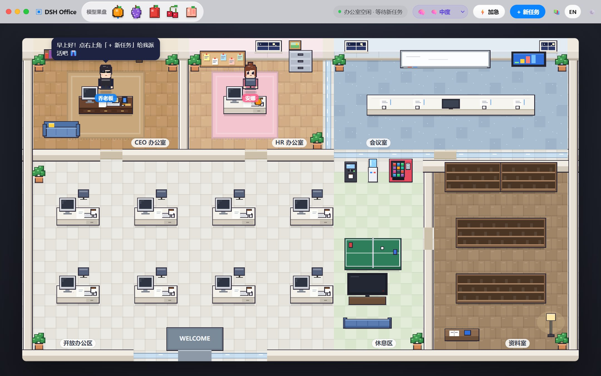
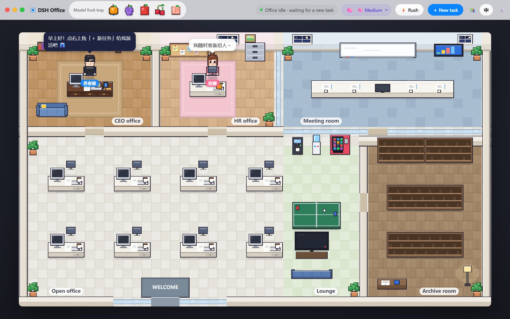
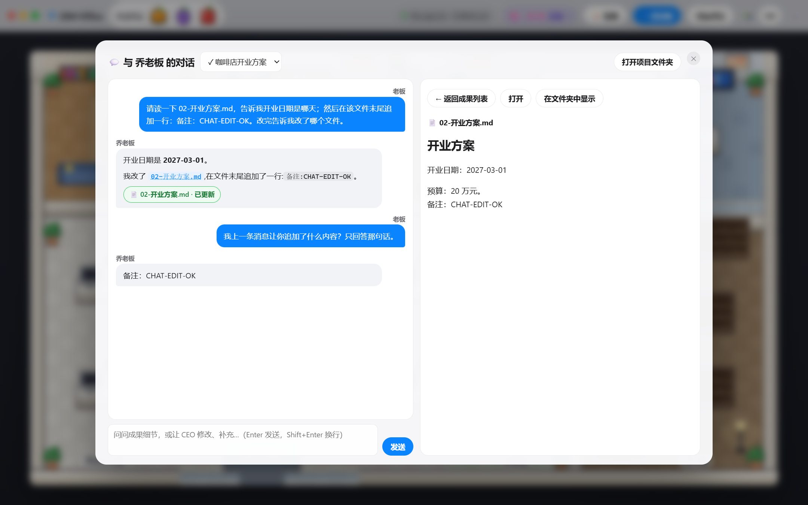
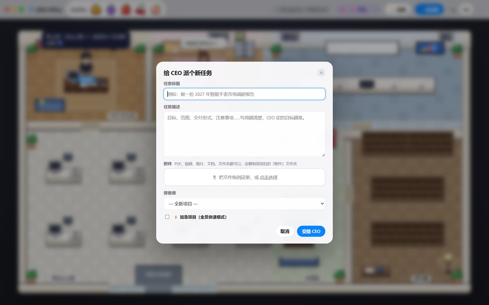
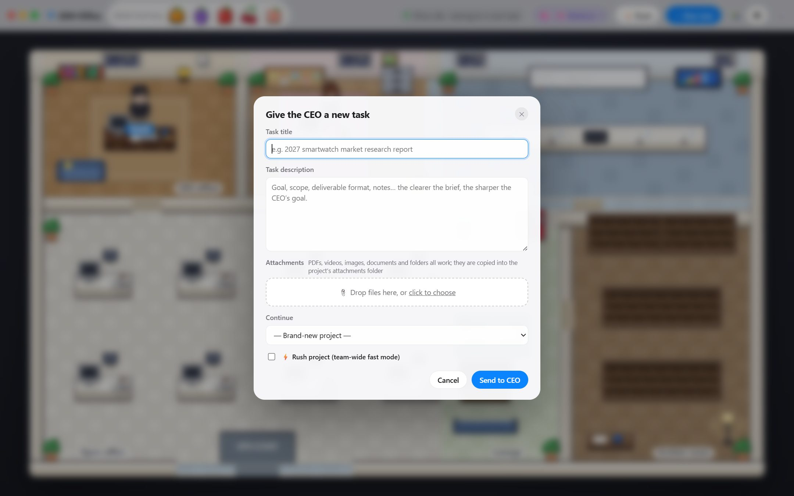
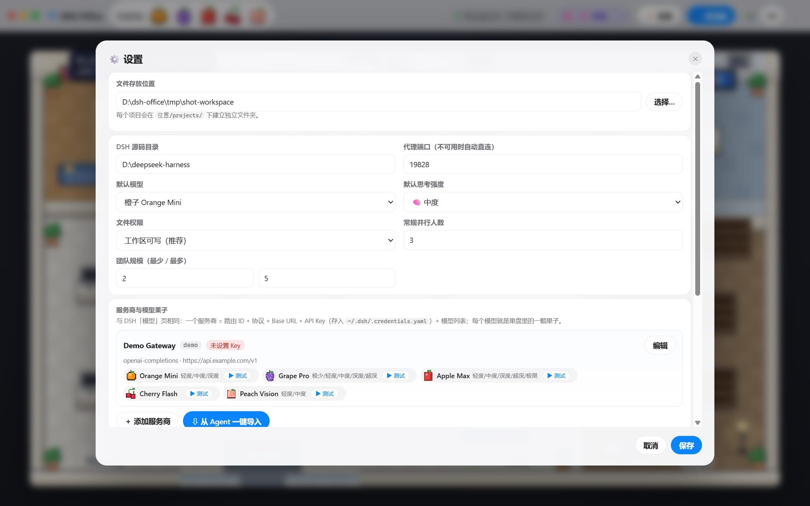
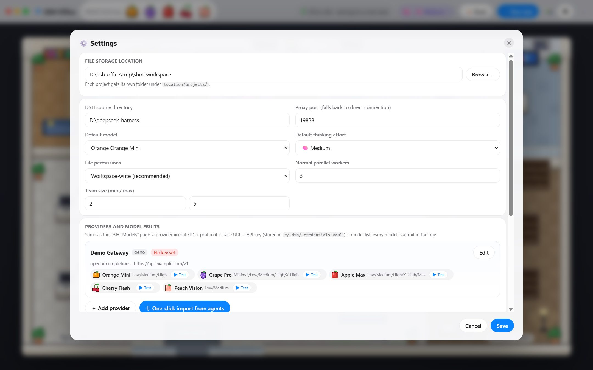

# DSH Office

**像素办公室多 Agent 协作桌面应用** — 给 DeepSeek Harness (DSH) 套上一间会动的像素办公室：你给 CEO 派任务，CEO 定目标、HR 招人分工、员工并行干活、HR 审核返工、CEO 验收归档，全部在一间像素风办公室里实时上演。

A pixel-office desktop UI over **DeepSeek Harness (DSH)**. Give the CEO a task; the CEO sets the goal, HR hires a team and schedules the work, employees execute in parallel with HR review/rework loops, and the CEO accepts and archives everything — acted out live in a pixel-art office.

---

## 截图 / Screenshots

**像素办公室：任务全流程实时上演 / The pixel office: the whole pipeline acted out live**

| 中文 | English |
|---|---|
|  |  |

**项目对话：与 CEO 连续对话，点击成果直接查看 / Project chat: talk to the CEO, click a deliverable to read it**



**新任务（可拖入附件）/ New task (drag in attachments)**

| 中文 | English |
|---|---|
|  |  |

**设置：服务商、模型果子、思考强度 / Settings: providers, model fruits, thinking effort**

| 中文 | English |
|---|---|
|  |  |

**服务商编辑：协议、Base URL、每模型输入/输出上限 / Provider editor: protocol, base URL, per-model token limits**

| 中文 | English |
|---|---|
|  |  |

> 截图使用演示配置（`api.example.com` 假数据），界面内不显示真实 API Key。
> Screenshots use demo data (`api.example.com`); the UI never shows raw API keys.

---

## 功能 / Features

**中文**

- 🕹️ **像素办公室**：CEO、HR 和员工在办公室里走动、开会、去咖啡机和休息区；任务全流程可视化。
- 🍇 **模型果子**：每个模型是果盘里的一颗水果，拖到员工身上即可换模型。
- 🔑 **服务商管理**：路由 ID + 协议（OpenAI Chat/Responses、Anthropic Messages）+ Base URL + API Key + 模型列表，与 DSH「模型」页完全同构。
- ⚡ **一键拉取并应用**：自动向 `/models` 拉取模型清单，并读取上下文窗口（最大输入）和最大输出 token，保存后立即生效。
- ⇩ **从其他 Agent 一键导入**：扫描本机的 **DSH、Codex、Claude Code、Hermes、opencode、cc-switch** 配置以及 **环境变量 / `.env`**（如 `DEEPSEEK_API_KEY`），勾选即导入并应用。
- 🧠 **思考强度**：按模型能力选择 `reasoningEffort` 档位（off/minimal/low/medium/high/xhigh/max），支持全员默认和单人覆盖；⚡加急模式全员快速冲刺。
- 🗂️ **资料室**：每个完成的项目变成书架上的一本书，可直接预览成果、目标、分工和审核记录。
- 🤖 **Codex CLI 当员工**：直接调用本机已安装并登录的 [Codex CLI](https://github.com/openai/codex)（ChatGPT 账号登录也行，无需 API Key）。「设置 → 服务商」里一键检测，把它的模型（如 GPT-6.1-Sol）加进果盘，拖给 CEO / HR / 任意员工即可；Codex 在项目目录里读写文件、执行命令，多轮对话保持上下文，默认限制在工作区内（Windows 用 elevated 沙箱）。可与 DSH 模型混编同一支团队。
- 💬 **项目对话窗口**：任务完成后自动弹出，左侧与 CEO 连续对话（带上下文，可追问、让他修改或补充成果），右侧是成果列表；**总结和主要成果一点就看**，对话里提到的文件也能直接点开，被 CEO 改过的文件会标「已更新」。对话记录保存在项目里，随时可回来继续。
- 🌏 **中英双语界面**：右上角 `EN/中` 一键切换，即时生效。

**English**

- 🕹️ **Pixel office**: CEO, HR and employees walk around, hold meetings, visit the coffee machine and lounge — the whole task pipeline is visualized.
- 🍇 **Model fruits**: every model is a fruit in the tray; drag one onto an employee to switch their model.
- 🔑 **Provider management**: route ID + protocol (OpenAI Chat/Responses, Anthropic Messages) + base URL + API key + model list — identical shape to the DSH Models page.
- ⚡ **Fetch & apply**: one click pulls the `/models` catalogue with context-window (max input) and max-output-token limits, saves and applies immediately.
- ⇩ **One-click agent import**: scans local configs from **DSH, Codex, Claude Code, Hermes, opencode, cc-switch** plus **environment variables / `.env`** (e.g. `DEEPSEEK_API_KEY`); tick and import.
- 🧠 **Thinking effort**: per-model `reasoningEffort` levels (off/minimal/low/medium/high/xhigh/max), with a team default and per-employee override; ⚡ rush mode puts everyone in fast gear.
- 🗂️ **Archive room**: every finished project becomes a book on the shelf, with previewable deliverables, goal, assignments and review history.
- 🤖 **Codex CLI as an employee**: calls the [Codex CLI](https://github.com/openai/codex) already installed and signed in on your machine (ChatGPT login works, no API key needed). Detect it under Settings → Providers, add its models (e.g. GPT-6.1-Sol) to the fruit tray and drag them onto the CEO, HR or any employee. Codex reads/writes files and runs commands in the project folder, keeps context across turns, and is confined to the workspace by default (elevated sandbox on Windows). Mix it freely with DSH models in one team.
- 💬 **Project chat window**: pops up when a task finishes. Chat with the CEO with full context (ask follow-ups, have them revise or extend the results) while the right pane lists the deliverables — **click the summary or any main deliverable to read it**, click files mentioned in the conversation, and files the CEO edited are flagged “updated”. Transcripts are saved in the project so you can come back anytime.
- 🌏 **Bilingual UI (Chinese + English)**: switch instantly with the `EN/中` button in the title bar.

---

## 上下文、输出与压缩 / Context, output & compaction

在 **设置 → 上下文与压缩** 中调整整个 Office 的自动压缩策略，包括触发比例、额外预留、摘要输出上限、近期原文保留比例、压缩重试、溢出恢复，以及可选的摘要服务商和模型。每个模型的实际触发量会实时显示；保存前会检查窗口、输出、预留和已知模型能力，项目运行期间会拒绝保存设置。

在 **设置 → 模型 → 编辑服务商** 中，可分别调整每个模型的上下文窗口、单次输出上限、模型最大输出能力、思考档位和图片输入。**检测连接与参数** 会发送一条短测试消息，并尝试获取该模型的参数；优先使用服务商返回的数据，再参考精确匹配的本地模型目录或现有配置，并显示来源和检测时间。模型列表不可用不会把成功的连接判成失败。通断测试不验证最大 token 容量，未返回的参数会标明未知；手动值可保留，读取到的声明能力上限不能通过提高请求预算绕过。

| 参数 | 20 万 token 窗口的建议示例 |
|---|---:|
| 单次输出预算 | 32,768，且不超过已知输出能力 |
| 压缩目标比例 | 80% |
| 额外预留 | 8,192 |
| 摘要输出上限 | 8,192 |
| 近期原文保留比例 | 扣除输出后窗口的 16% |
| 压缩额外尝试 / 溢出恢复 | 1 / 1 |

实际触发量是 `min(窗口 × 触发比例, 窗口 − 单次输出预算 − 额外预留)`。以上示例为 **159,040 token（79.5%）**。建议按配置窗口缩放，并受已知模型输出能力约束；这不是对任何模型真实容量的承诺。旧版本未设置单次输出预算时，会在启动时迁移为明确的建议预算。加急模型有独立模型条目时使用其自己的窗口、输出、思考与图片参数；未独立添加时沿用原模型配置。摘要预算预检按实际触发量估算，单次大量工具结果跨过阈值时仍由 DSH 的运行时溢出恢复处理。

**English:** Under **Settings → Context & compaction**, edit the Office-wide policy and inspect each model's effective trigger. Under a provider's model editor, edit its shared context window, request output budget, declared output capability, reasoning levels, and image support. **Test connection & read limits** probes connectivity and reads exact-model metadata, preferring provider data over a matching local catalog or saved configuration. Missing metadata stays unknown; a successful short probe does not verify maximum capacity. Recommendations scale with the configured window and known output capability. Saving validates budgets in both the renderer and main process. Office writes a final runtime overlay so global Harness defaults cannot silently override the choices saved here.

Offline validation: `node --test scripts/parameters.test.cjs scripts/test-providers.cjs`. Tests use fixtures and do not call a user's model provider.

## 运行前提 / Requirements

**中文**

- Windows 10/11 (x64)、Linux (x64) 或 macOS（Apple Silicon / Intel）。
- 一份可用的 **DeepSeek Harness** 源码目录（需要其中的 `apps/cli/lib/bin.js` 及 `yaml` 等依赖）。默认查找位置：
  - Windows：`D:\deepseek-harness`
  - Linux/macOS：`/opt/deepseek-harness`、`~/deepseek-harness`，也可在「设置 → DSH 源码目录」里手动指定。
- `node` 在 PATH 上（用于拉起 DSH 运行时）。
- 至少一个 OpenAI / Anthropic 兼容的模型服务商和 API Key，或直接使用一键导入。

**English**

- Windows 10/11 (x64), Linux (x64), or macOS (Apple Silicon / Intel).
- A working **DeepSeek Harness** checkout (it provides `apps/cli/lib/bin.js` and the `yaml` dependency). Default search paths:
  - Windows: `D:\deepseek-harness`
  - Linux/macOS: `/opt/deepseek-harness`, `~/deepseek-harness`, or set it manually under **Settings → DSH source directory**.
- `node` on PATH (used to spawn the DSH runtime).
- At least one OpenAI/Anthropic-compatible provider with an API key — or just use the one-click importer.

---

## 下载安装 / Install

预编译包见 [Releases](https://github.com/reymondmeking-dot/dsh-office/releases)（Windows、Linux、macOS arm64/x64）。
Prebuilt packages are on the [Releases](https://github.com/reymondmeking-dot/dsh-office/releases) page (Windows, Linux, macOS arm64/x64).

### Windows

下载 `DSH-Office-windows-x64.zip`，解压后运行 `DSH Office.exe`（本地运行 `scripts/build.ps1` 还会创建桌面和开始菜单快捷方式）。

Download `DSH-Office-windows-x64.zip`, unzip, and run `DSH Office.exe` (building locally via `scripts/build.ps1` also creates Desktop/Start-Menu shortcuts).

### Linux

```bash
tar -xzf dsh-office-linux-x64.tar.gz
cd dsh-office-linux-x64
./install.sh            # 安装到 ~/Applications 并创建 .desktop / installs to ~/Applications + .desktop
# 或直接运行 / or run directly: ./"DSH Office.sh"
```

Debian/Ubuntu 运行时依赖 / runtime libraries:

```bash
sudo apt install libgtk-3-0 libnss3 libatk1.0-0 libatk-bridge2.0-0 libcups2 \
  libdrm2 libxkbcommon0 libxcomposite1 libxdamage1 libxfixes3 libxrandr2 \
  libgbm1 libasound2 libpango-1.0-0 libcairo2
```

### macOS

- Apple Silicon（M 系列）→ `DSH-Office-macos-arm64.zip`
- Intel → `DSH-Office-macos-x64.zip`

解压后把 `DSH Office.app` 拖到「应用程序」。本应用没有 Apple Developer 签名（ad-hoc 临时签名），首次启动请**右键 → 打开 → 打开**；如仍被 Gatekeeper 拦截：

Unzip, drag `DSH Office.app` to Applications. The app is **ad-hoc signed (no Apple Developer ID)** — first launch via **right-click → Open → Open**; if Gatekeeper still blocks it:

```bash
xattr -dr com.apple.quarantine "/Applications/DSH Office.app"
```

---

## 使用 / Quick start

1. 打开应用，点右上角 **⚙️ 设置**。
2. 点 **⇩ 从 Agent 一键导入**，勾选扫描到的服务商，导入即自动应用；或点 **＋ 添加服务商** 手动填写，再用 **⚡ 一键拉取并应用**。
3. 点 **＋ 新任务**，写标题和描述（可拖入附件/文件夹），提交。
4. 看 CEO 定目标、HR 开工会招人、员工交付审核，完成后去 **📚 资料室** 翻书。

1. Open the app and click **⚙️ Settings**.
2. Click **⇩ One-click import from agents**, tick the found providers and import; or **＋ Add provider** manually, then **⚡ Fetch & apply**.
3. Click **＋ New task**, fill in the title and brief (drag files/folders in as attachments), submit.
4. Watch the CEO set goals, HR run kickoff and hire, employees deliver and get reviewed; finished projects land in the **📚 Archive room**.

---

## 密钥与隐私 / Keys & privacy

**中文**

- API Key 只写入 DSH 标准凭据文件 `~/.dsh/.credentials.yaml`（权限 0600），界面只显示打码（`••••1234`）。
- 一键导入时，原始密钥始终留在 Electron 主进程，不经过渲染界面，也不会写进项目文件或日志。
- 项目文件默认在 `~/Documents/DSH Office/projects/`，每个项目一个文件夹（附件复制到其 `附件/` 子目录）。
- 删除服务商不会删除凭据文件里的 Key。

**English**

- API keys are written only to the standard DSH credential file `~/.dsh/.credentials.yaml` (mode 0600); the UI only ever shows masks like `••••1234`.
- During import, raw keys stay inside the Electron main process and never cross into the renderer, projects, or logs.
- Projects live under `~/Documents/DSH Office/projects/`, one folder per project (attachments are copied into its attachments subfolder).
- Deleting a provider does not delete its key from the credential file.

---

## 从源码构建 / Build from source

需要 Node.js 18+；构建脚本会自动下载 Electron 39.8.5 预编译包。/ Requires Node.js 18+; the scripts download Electron 39.8.5 automatically.

```powershell
# Windows (PowerShell)
powershell -ExecutionPolicy Bypass -File scripts/build.ps1
# -> dist/DSH Office/DSH Office.exe
```

```bash
# Linux
bash scripts/build-linux.sh          # -> dist/dsh-office-linux-x64.tar.gz

# macOS（在对应架构的机器上运行 / run natively on matching hardware）
bash scripts/build-macos.sh arm64    # -> dist/DSH-Office-macos-arm64.zip
bash scripts/build-macos.sh x64      # -> dist/DSH-Office-macos-x64.zip
```

推一个 `v*` tag 会触发 GitHub Actions，在 Windows / Ubuntu / macOS arm64 / macOS x64 四种 runner 上出包并发布 Release。

Pushing a `v*` tag triggers GitHub Actions which builds all four packages (Windows, Linux, macOS arm64, macOS x64) and publishes a Release.

---

## 项目结构 / Project layout

```
app/
  main.cjs            Electron main: window, settings, CEO→HR→employee orchestration
  runtime.cjs         DSH CLI subprocess pool + office profile writer
  codex.cjs           Codex CLI engine: detect, model catalogue, `codex exec --json` runtime
  providers.cjs       credentials, /models discovery, model test, DSH config reads
  agents.cjs          scanner for Codex/Claude/Hermes/opencode/cc-switch/env configs
  preload.cjs         contextIsolation IPC bridge
  renderer/           pixel-office canvas and all UI (index.html, office.js, app.js,
                      sprites.js, i18n.js shared zh/en dictionary)
  harness/            CEO / HR / employee role prompt templates
scripts/              per-platform packaging, icon generator, Linux test Dockerfile
.github/workflows/    release.yml: four-platform build + GitHub Release
```

## License

MIT，见 [LICENSE](LICENSE)。/ MIT, see [LICENSE](LICENSE).
