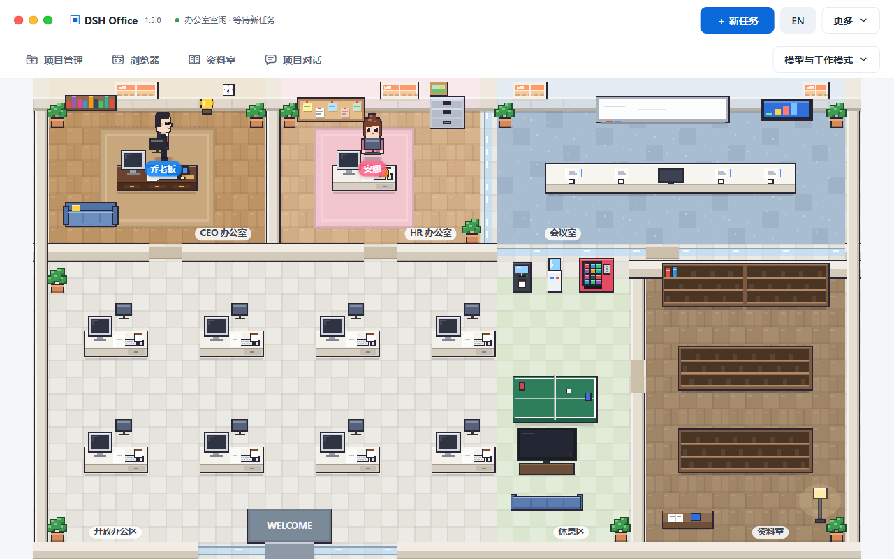
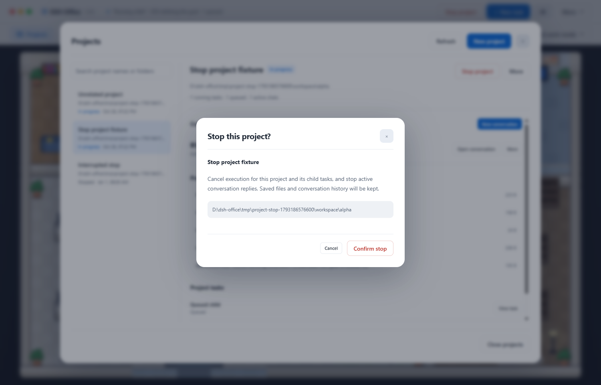
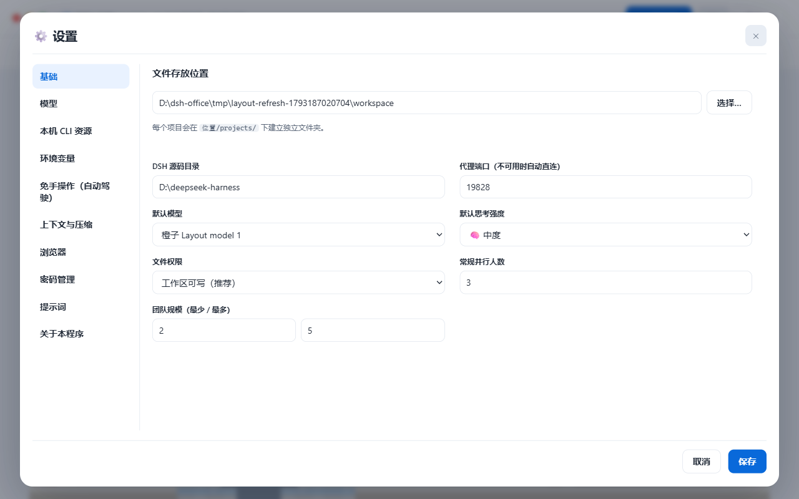
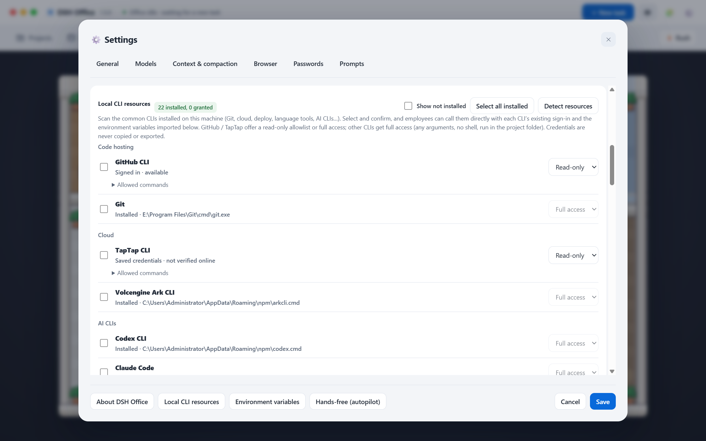
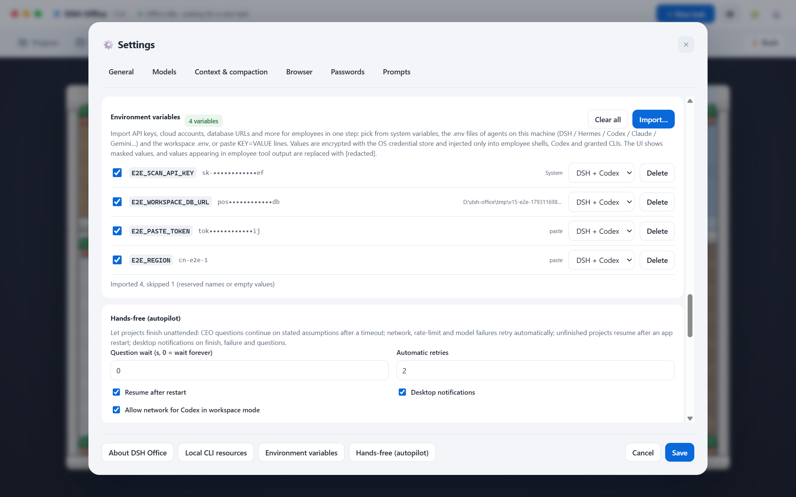
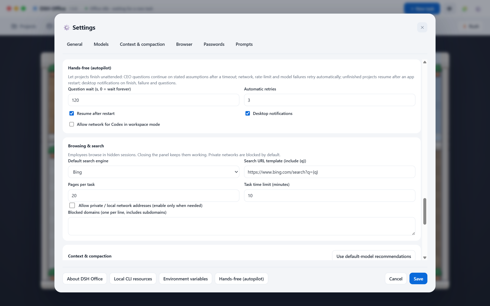

# DSH Office 1.5.0

<p align="center">
  <a href="docs/demo/dsh-office-1.4.0-demo.mp4">
    
  </a>
  <br />
  <b>▶ <a href="docs/demo/dsh-office-1.4.0-demo.mp4">Watch the 1.4.0 demo — English (39 s, narrated)</a> · <a href="docs/demo/dsh-office-1.4.0-demo-zh.mp4">观看中文版（45 秒，配音）</a></b>
</p>

> 画面均为 1.4.0 真实界面截图（隔离演示数据，无头捕获），加入镜头推近、高亮、字幕、配音和配乐；浏览器页为真实打开的公开网页。这是功能导览，并非一次员工完整任务的连续录像。
>
> Every frame is a real 1.4.0 UI capture (isolated demo data, headless), with camera moves, highlights, captions, narration and music; the browser shows a real public page. It is a feature tour, not a continuous recording of a complete employee task.

**像素办公室多 Agent 协作桌面应用** — 给 DeepSeek Harness (DSH) 套上一间会动的像素办公室：你给 CEO 派任务，CEO 定目标、HR 招人分工、员工并行干活、HR 审核返工、CEO 验收归档，全部在一间像素风办公室里实时上演。

A pixel-office desktop UI over **DeepSeek Harness (DSH)**. Give the CEO a task; the CEO sets the goal, HR hires a team and schedules the work, employees execute in parallel with HR review/rework loops, and the CEO accepts and archives everything — acted out live in a pixel-art office.

**1.5.0 · 解放双手**：[一键导入 59 类本机 CLI（读 / 完全授权）](#本机-cli-资源--local-cli-resources) · [一键导入环境变量（加密、注入、遮蔽）](#环境变量--environment-variables) · [免手操作：提问超时继续、故障自动重试、重启续跑、系统通知](#免手操作自动驾驶--hands-free-autopilot) · [与 Hermes / Codex / Claude Code 对比](#与主流-agent-对比--compared-with-hermes-codex-and-claude-code)

**1.5.0 · hands-free**: [one-click import of 59 kinds of local CLIs (read / full access)](#本机-cli-资源--local-cli-resources) · [one-click environment-variable import (encrypted, injected, redacted)](#环境变量--environment-variables) · [autopilot: question timeout, automatic retries, resume after restart, notifications](#免手操作自动驾驶--hands-free-autopilot) · [Compared with Hermes / Codex / Claude Code](#与主流-agent-对比--compared-with-hermes-codex-and-claude-code)

> 演示视频与截图仍为 1.4.0 界面；1.5.0 新增的设置区截图见下文。/ The demo video and screenshots show the 1.4.0 UI; 1.5.0 settings screenshots are below.

**本次界面更新 / Latest layout update**：项目详情和运行中的对话提供「停止项目」，确认后取消该项目及子任务、排队任务和生成中的回复，保留文件与历史。已主动停止的任务不会在重启后自动续跑。标题栏保留主要入口，次要操作收入「更多」菜单；模型与工作模式按需展开，设置按左侧类别切换。

Project details and active conversations now offer **Stop project**. Confirmation cancels that project's running and queued child tasks and active replies while preserving files and history. Explicitly stopped tasks do not resume automatically after restart. Primary actions stay visible, secondary actions use More menus, model controls open on demand, and Settings uses a category sidebar.

办公室四周使用浅色背景，画面等比适配可用空间，去掉黑边和深色阴影。/ The office uses a light surrounding surface and fits the available space without cropping, dark gutters or heavy shadows.

| 当前办公室 / Current office | 项目与停止操作 / Projects and stop |
|---|---|
|  |  |



以上为隔离数据、无头捕获的当前界面；上方视频仍标记为 1.4.0 导览。/ These current UI captures use isolated data and headless execution. The video above remains labeled as the 1.4.0 tour.

**1.4.0**：[项目与多对话](#项目多对话与成果引用--projects-conversations--references) · [浏览器与文件预览](#浏览器文件预览与本地密码--browser-file-previews--local-passwords) · [本机 CLI 资源](#本机-cli-资源--local-cli-resources)

**1.4.0**: [Projects & conversations](#项目多对话与成果引用--projects-conversations--references) · [Browser & file previews](#浏览器文件预览与本地密码--browser-file-previews--local-passwords) · [Local CLI resources](#本机-cli-资源--local-cli-resources)

<details>
<summary>旧版宣传片 / Earlier promo（40 秒，带配音 / 40 seconds, with sound）</summary>

<p align="center">
  <a href="https://github.com/reymondmeking-dot/dsh-office/releases/download/v1.2.1/dsh-office-promo.mp4">
    
  </a>
  <br />
  <a href="https://github.com/reymondmeking-dot/dsh-office/releases/download/v1.2.1/dsh-office-promo.mp4">观看旧版宣传片 / Watch the earlier promo</a>
</p>

该视频展示较早版本的整体工作流程，界面与 1.4.0 有所不同。
This video shows the overall workflow in an earlier version; its interface differs from 1.4.0.

</details>

---

## 截图 / Screenshots

**双层标题栏与像素办公室 / Two-level title bar & pixel office**

| 中文 | English |
|---|---|
|  |  |

**项目管理：保存位置、独立对话与成果引用 / Projects: save location, separate conversations & references**

| 中文 | English |
|---|---|
|  |  |

**项目对话：切换上下文，直接查看成果 / Project chat: switch contexts & open deliverables**

| 中文 | English |
|---|---|
|  |  |

**文件查看器：在应用内阅读交付物 / File viewer: read deliverables inside the app**

| 中文 | English |
|---|---|
|  |  |

**本机 CLI：一键检测，勾选确认授权 / Local CLIs: detect, select & confirm access**

| 中文 | English |
|---|---|
|  |  |

> 以上为 1.4.0 的真实界面截图，项目内容使用隔离演示数据。CLI 页仅做本机只读检测，未在演示中授权资源；截图不含密码或 API Key。
>
> These are real 1.4.0 UI captures with isolated demo project content. The CLI screen shows a local read-only detection result; no access was granted for this demo. No password or API key is shown.

---

## 功能 / Features

**中文**

- 🕹️ **像素办公室**：CEO、HR 和员工在办公室里走动、开会、去咖啡机和休息区；任务全流程可视化。
- 🍇 **模型果子**：每个模型是果盘里的一颗水果，拖到员工身上即可换模型。
- 🔑 **服务商管理**：路由 ID + 协议（OpenAI Chat/Responses、Anthropic Messages）+ Base URL + API Key + 模型列表，与 DSH「模型」页完全同构。
- ⚡ **一键拉取并应用**：自动向 `/models` 拉取模型清单，并读取上下文窗口（最大输入）和最大输出 token，保存后立即生效。
- ⇩ **从其他 Agent 一键导入**：扫描本机的 **DSH、Codex、Claude Code、Hermes、opencode、cc-switch** 配置以及 **环境变量 / `.env`**（如 `DEEPSEEK_API_KEY`），勾选即导入并应用。
- 🧠 **思考强度**：按模型能力选择 `reasoningEffort` 档位（off/minimal/low/medium/high/xhigh/max），支持全员默认和单人覆盖；⚡加急模式全员快速冲刺。
- 🗂️ **资料室**：每个完成的项目变成书架上的一本书，可直接预览成果、目标、分工和审核记录。
- 🤖 **Codex CLI 当员工**：直接调用本机已安装并登录的 [Codex CLI](https://github.com/openai/codex)（ChatGPT 账号登录也行，无需 API Key）。「设置 → 服务商」里一键检测，设置里是一张表格：横排是模型，竖列是思考深度，左上角是⚡快速模式开关。滑动某个模型的开关即启用（整列变色并进入果盘，拖给 CEO / HR / 任意员工即可），在某个深度打勾就是它的默认思考深度，改动即时生效；Codex 在项目目录里读写文件、执行命令，多轮对话保持上下文，默认限制在工作区内（Windows 用 elevated 沙箱）。可与 DSH 模型混编同一支团队。
- 💬 **项目对话窗口**：任务完成后自动弹出，左侧与 CEO 连续对话（带上下文，可追问、让他修改或补充成果），右侧是成果列表；**总结和主要成果一点就看**，对话里提到的文件也能直接点开，被 CEO 改过的文件会标「已更新」。对话记录保存在项目里，随时可回来继续。
- 🌏 **中英双语界面**：右上角 `EN/中` 一键切换，即时生效。
- 🧩 **扩展中心：插件、MCP、技能、专家库**（详见下文）。

**English**

- 🕹️ **Pixel office**: CEO, HR and employees walk around, hold meetings, visit the coffee machine and lounge — the whole task pipeline is visualized.
- 🍇 **Model fruits**: every model is a fruit in the tray; drag one onto an employee to switch their model.
- 🔑 **Provider management**: route ID + protocol (OpenAI Chat/Responses, Anthropic Messages) + base URL + API key + model list — identical shape to the DSH Models page.
- ⚡ **Fetch & apply**: one click pulls the `/models` catalogue with context-window (max input) and max-output-token limits, saves and applies immediately.
- ⇩ **One-click agent import**: scans local configs from **DSH, Codex, Claude Code, Hermes, opencode, cc-switch** plus **environment variables / `.env`** (e.g. `DEEPSEEK_API_KEY`); tick and import.
- 🧠 **Thinking effort**: per-model `reasoningEffort` levels (off/minimal/low/medium/high/xhigh/max), with a team default and per-employee override; ⚡ rush mode puts everyone in fast gear.
- 🗂️ **Archive room**: every finished project becomes a book on the shelf, with previewable deliverables, goal, assignments and review history.
- 🤖 **Codex CLI as an employee**: calls the [Codex CLI](https://github.com/openai/codex) already installed and signed in on your machine (ChatGPT login works, no API key needed). Detect it under Settings → Providers, settings show a spreadsheet — models across the top, thinking depth down the left, ⚡ fast-mode switch in the corner. Slide a model on to enable it (its column lights up and it joins the fruit tray; drag it onto the CEO, HR or any employee), tick a depth to make it that model's default; changes apply instantly. Codex reads/writes files and runs commands in the project folder, keeps context across turns, and is confined to the workspace by default (elevated sandbox on Windows). Mix it freely with DSH models in one team.
- 💬 **Project chat window**: pops up when a task finishes. Chat with the CEO with full context (ask follow-ups, have them revise or extend the results) while the right pane lists the deliverables — **click the summary or any main deliverable to read it**, click files mentioned in the conversation, and files the CEO edited are flagged “updated”. Transcripts are saved in the project so you can come back anytime.
- 🌏 **Bilingual UI (Chinese + English)**: switch instantly with the `EN/中` button in the title bar.
- 🧩 **Extensions: plugins, MCP, skills and experts** (see below).

---

## 项目、多对话与成果引用 / Projects, conversations & references

**中文**

- 标题栏「项目管理」按名称或文件夹搜索项目，查看实际保存目录、成果文件、项目任务与对话；「资料室」仍保留原有书架视图。新建项目后即可创建对话，也可以给已有任务项目添加多个对话。
- **创建前确认位置**：输入项目名称后先预览工作区内的实际文件夹，可修改路径或选择现有文件夹；点击「确认位置并创建」才写入项目元数据。创建拒绝工作区外路径、链接 / 目录联接，以及已经有项目元数据的目录；不会覆盖旧项目或清空目录里的其他文件。新建任务也显示并要求确认成果位置，可归属一个已有项目，或作为独立任务保存。
- **每项目多个独立对话**：对话名称、消息历史与引用分别持久化；默认对话兼容旧的聊天记录。切换对话保留各自的上下文，同一项目的对话共享该项目的成果文件夹。当前同项目一次处理一轮回复；尚在排队 / 执行的任务完成后才能继续成果对话。
- **显式引用完成成果**：创建对话时勾选，或在「管理引用」中确认保存。仅可引用其他已完成项目，界面保留来源标题与真实目录；当前对话得到来源摘要和目录作为只读参考。引用关系本身不复制、合并或修改来源文件；新成果仍保存到当前项目。

**English**

- Projects in the title bar searches names / folders and shows the actual directory, output files, project tasks and conversations. Archive room keeps its original bookshelf view. A new project is ready for conversations; existing task projects can also have multiple conversations.
- **Confirm the location before creating**: naming a project previews its exact workspace folder. Edit the path or choose an existing folder, then select Confirm location and create to write metadata. Creation rejects outside-workspace paths, links / junctions and folders with existing project metadata. It neither overwrites an old project nor clears other files in the folder. New tasks also display and require confirmation of their output location, and can belong to an existing project or remain standalone.
- **Separate conversations within each project**: conversation names, messages and references persist independently; the default conversation preserves legacy chat records. Switching conversations keeps their contexts separate while sharing the project's output folder. One reply runs at a time within a project; queued / running tasks must finish before further result conversations.
- **Explicit references to completed outputs**: select sources while creating a conversation, or confirm changes under Manage references. Only other completed projects can be referenced. Source titles and real directories remain visible; the current conversation receives their summaries and directories as read-only references. Creating a reference does not copy, merge or modify source files. New outputs stay in the current project.

---

## 浏览器、文件预览与本地密码 / Browser, file previews & local passwords

**中文**

- **浏览器面板**：标题栏「浏览器」打开标签页、地址栏、前进 / 后退 / 刷新、加载状态与「系统浏览器」入口。非网址输入直接搜索；设置支持 Bing、DuckDuckGo、Google 和包含 `{q}` 的自定义搜索 URL。默认使用 **Bing**。
- **隐藏员工会话**：默认启用的内置 `office-browser` 插件通过现有 MCP 接线同时服务 DSH 和 Codex。每次员工会话拥有独立、非持久化的 Chromium session；任务结束回收。浏览操作在隐藏 WebContents 中进行，打开面板即可围观同一个会话；关闭面板不停止工作。「接管标签页」交还用户操作，并暂停该标签页的员工浏览工具。
- **工作区文件预览**：资料室与交付文件可在应用内打开 Markdown、图片、PDF、HTML，以及只读等宽代码 / 文本。路径先解析 realpath，再检查是否位于 `settings.workspace` 内；越界路径和链接被拒绝。文本预览 / 员工文件读取上限 2 MB，图片、PDF、HTML 预览上限 50 MB。下载存入工作区 `downloads/`，面板显示下载提示。
- **HTML 交付物沙箱**：支持本地同目录资源、内联样式与脚本；不授予 Node、preload 或同源权限。CSP 禁止外网资源、网络 API、嵌套 frame / object 和表单提交；依赖外部 CDN、远程 API 或嵌入页面的交付物不能完整运行。PDF 使用 Chromium 内置查看器。
- **本地密码库**：登录表单提交时询问是否保存；再次访问相同 origin 可一键填充。密码通过 Electron `safeStorage`（Windows 为 DPAPI）加密，`<userData>/vault.json` 只存密文；系统安全存储不可用时拒绝保存。密码管理页支持站点列表、填充、复制、删除与二次确认导出。**导出是供本机系统凭据环境使用的密文备份，不是明文导出或跨电脑迁移功能。**
- **凭据边界**：员工只能请求 `browser_login(origin)`，必须由用户在 Office 界面确认，随后主进程直接填表；模型接口仅返回待确认 / 操作状态。工具返回值递归遮蔽已知密码及常见 URL 编码形式；日志不记录密码。员工截图会遮蔽表单控件、frame 等内容；标签页使用过凭据，或当前 origin 已保存密码时，**不捕捉页面，生成安全占位图并返回 `protected:true`**，因此不能用此工具获取登录页面的完整截图。
- **浏览安全默认值**：内网 / 本地地址默认关闭，`file://` 不开放；可在设置中允许内网，或配置域名黑名单（包含子域名）。员工每次浏览会话默认最多 **20 页、10 分钟**。页面内容属于不可信输入；搜索站点可能返回验证码、限流页或暂时无法解析的结果，工具会明确返回空结果提示。

浏览器仅复用构建所用 **Electron 39.8.5 自带的 Chromium / WebContentsView**。本功能没有新增 npm 依赖、CEF、独立 Chromium 或 Playwright 浏览器下载。用户标签页使用 `persist:office-browser`；远程页面均为 `sandbox:true`、`contextIsolation:true`、`nodeIntegration:false`，不加载 preload。MCP stdio 脚本通过本机回环服务与每次启动随机 token 连接主进程，token 经子进程环境传递。

**English**

- **Browser panel**: open Browser in the title bar for tabs, an address bar, back / forward / reload, loading state and Open externally. Non-URL input becomes a search. Settings offer Bing, DuckDuckGo, Google and a custom search URL containing `{q}`. **Bing** is the default.
- **Hidden employee sessions**: the enabled-by-default `office-browser` plugin uses the existing MCP wiring for both DSH and Codex. Each employee run gets an isolated, non-persistent Chromium session, released when the run ends. Browsing happens in hidden WebContents. Open the panel to follow the same session; hiding it keeps the employee working. Take over tab enables user input and pauses employee browser tools for that tab.
- **Workspace file previews**: open Markdown, images, PDF, HTML and read-only monospace code / text from the archive or deliverables. Paths are resolved with realpath and checked against `settings.workspace`; traversal and escaping links are rejected. Text previews / employee file reads are limited to 2 MB; image, PDF and HTML previews to 50 MB. Downloads go into workspace `downloads/` and appear in the panel.
- **Sandboxed HTML deliverables**: local resources in the document directory, inline styles and scripts are supported, without Node, a preload or same-origin privileges. CSP blocks external resources, network APIs, nested frames / objects and form submission. Deliverables needing a CDN, remote API or embedded page cannot run completely. PDF uses Chromium's built-in viewer.
- **Local password vault**: form submission prompts to save, and the same origin can be filled on a later visit. Electron `safeStorage` (DPAPI on Windows) encrypts the data; `<userData>/vault.json` contains ciphertext only. Saving is refused if OS secure storage is unavailable. Password management lists sites and supports fill, copy, delete and export with two confirmations. **Export is an encrypted backup for the same computer and OS credential environment; it is neither plaintext export nor cross-computer migration.**
- **Credential boundary**: employees can only request `browser_login(origin)`. A user must confirm in Office before the main process fills the form; the model-facing interface returns pending / operation status only. Tool responses recursively redact known passwords and common URL-encoded variants; passwords are not logged. Employee screenshots mask form controls and frames. For a tab that has used credentials, or whose current origin has a saved password, the tool **does not capture the page: it creates a safety placeholder and returns `protected:true`**.
- **Safe browsing defaults**: private / local networks are blocked and `file://` is not exposed. Settings can explicitly permit private networks and configure blocked domains, including subdomains. Each employee browser session defaults to **20 pages and 10 minutes**. Treat page content as untrusted. Search sites may challenge, rate-limit or return markup the parser cannot read; the tool reports an explicit empty-results message.

This feature reuses **Electron 39.8.5's bundled Chromium / WebContentsView**. It adds no npm dependency, CEF, standalone Chromium or Playwright browser download. User tabs use `persist:office-browser`; remote pages run with `sandbox:true`, `contextIsolation:true`, `nodeIntegration:false` and no preload. A dependency-free stdio MCP script connects to a loopback-only main-process service using a fresh startup token passed through the child environment.

工具名称 / Tool names (model-facing prefix: `mcp__office-browser__`):

| 工具 / Tool | 用途 / Purpose |
|---|---|
| `browser_search(query, count?)` | 搜索标题、URL、摘要 / Search titles, URLs and snippets |
| `browser_open(url)` | 打开页面并读取正文 / Open a page and read its text |
| `browser_snapshot()` | 获取精简交互元素与 ref / List concise interactive elements and refs |
| `browser_click(ref)` | 按 ref 点击 / Click by ref |
| `browser_type(ref, text, submit?)` | 填写普通表单 / Fill a regular form field |
| `browser_select(ref, value)` | 选择选项 / Select an option |
| `browser_scroll(dir)` | 向上 / 下滚动 / Scroll up or down |
| `browser_screenshot()` | 保存到项目 browser-shots/ / Save into project browser-shots/ |
| `browser_read_file(path)` | 读取工作区文件 / Read a workspace file |
| `browser_login(origin)` | 请求用户确认后填充凭据 / Request user-approved credential filling |

例如 / Example: `mcp__office-browser__browser_search`. DOM / ref 操作优先；没有可用 DOM 点击方法时才使用 Chromium 输入事件。/ DOM / ref actions take priority; Chromium input events are a fallback when an element has no usable DOM click method.

---

## 本机 CLI 资源 / Local CLI resources

<p align="center"></p>

**中文**

「设置 → 本机 CLI 资源 → 一键检测」扫描本机常用 CLI，内置 59 项，按类别分组：代码托管（Git、GitHub、GitLab）、云平台（AWS、Azure、gcloud、阿里云、腾讯云、火山方舟 arkcli、TapTap）、部署 / 基础设施（Vercel、Netlify、Wrangler、Fly、Railway、Supabase、Firebase、Heroku、Stripe、Terraform、Pulumi）、容器（Docker、Podman、kubectl、Helm）、语言与包管理（Node、npm、pnpm、Yarn、Bun、Deno、Python、pip、uv、Cargo、Go、Java、Maven、Gradle、dotnet 等）、数据库（psql、mysql、sqlite3、redis-cli）、多媒体（ffmpeg、ImageMagick）、工具（ripgrep、jq、adb、飞书 lark-cli 等）以及 AI CLI（Ollama、Codex、Claude Code、Gemini、Qwen、OpenCode、Hermes）。未在目录中的 CLI 可填可执行文件的绝对路径「添加自定义 CLI」。实际列出多少取决于本机安装情况；本机实测扫描到 22 个已安装项。

资源**默认不授权**。勾选（或「全选已安装」）后点「确认所选授权」，再在确认框中确认，员工才能调用。两种授权：

- **只读**（仅 GitHub CLI / TapTap CLI 可选）：沿用 1.4 的白名单，只开放列出的查看 / 列表 / 搜索命令，TapTap 还需命令帮助声明 `Risk: read`。
- **完全授权**（其他 CLI 均为此模式，GitHub / TapTap 也可选）：员工可传入任意参数，包括写入、推送、部署和删除。命令以参数数组直接启动，**不经过 shell 字符串**；`.cmd` / `.ps1` 包装脚本由 Office 选择对应解释器启动。工作目录固定为当前项目目录。超时 5–600 秒（默认 120 秒），输出上限 256 KB。

CLI 进程继承本机登录状态（如 `gh` / `aws` / `kubectl` 的已有配置），并注入下方「环境变量」中已启用的变量。输出会遮蔽凭据形态的字符串和已导入的密钥值。取消勾选并确认即可撤销，下一次调用立即生效。Office 不复制、不导出 CLI 的登录凭据。完全授权意味着员工能以你的账号执行破坏性操作，请只勾选确实需要的 CLI。

内置 `office-cli` MCP 插件同时挂到 DSH 与 Codex，提供 `mcp__office-cli__cli_list_resources` 与 `mcp__office-cli__cli_call`（`resource`、`args`、可选 `timeoutSec`）。

**English**

Settings → Local CLI resources → Detect resources scans for common CLIs: 59 built-in entries grouped by category. Categories: code hosting (Git, GitHub, GitLab); cloud (AWS, Azure, gcloud, Alibaba Cloud, Tencent Cloud, Volcengine Ark, TapTap); deploy / infrastructure (Vercel, Netlify, Wrangler, Fly, Railway, Supabase, Firebase, Heroku, Stripe, Terraform, Pulumi); containers (Docker, Podman, kubectl, Helm); languages and package managers (Node, npm, pnpm, Yarn, Bun, Deno, Python, pip, uv, Cargo, Go, Java, Maven, Gradle, dotnet…); databases (psql, mysql, sqlite3, redis-cli); media (ffmpeg, ImageMagick); tools (ripgrep, jq, adb, Lark CLI…); and AI CLIs (Ollama, Codex, Claude Code, Gemini, Qwen, OpenCode, Hermes). To add a CLI that is not in the catalog, use Add custom CLI with the absolute path to its executable. How many appear depends on what is installed; the scan found 22 on the development machine.

Resources are **not authorized by default**. Tick them (or Select all installed), choose Confirm selected access, then confirm in the dialog. Two grant levels:

- **Read-only** (GitHub CLI / TapTap CLI only): the 1.4 allowlist of view / list / search commands. TapTap commands must also declare `Risk: read`.
- **Full access** (every other CLI; optional for GitHub / TapTap): employees can pass any arguments, including writes, pushes, deploys and deletes. Commands launch from an argument array, **never a shell string**; Office picks the interpreter for `.cmd` / `.ps1` wrappers. The working directory is the current project. Timeout is 5–600 s (default 120 s) and output is capped at 256 KB.

CLI processes keep the machine's existing sign-ins (for example `gh`, `aws` or `kubectl` configuration) and receive the enabled variables from Environment variables below. Output redacts credential-shaped strings and imported secret values. Untick and confirm to revoke; the next call is affected immediately. Office never copies or exports CLI credentials. Full access lets employees run destructive commands with your accounts, so grant only the CLIs a project needs.

The built-in `office-cli` MCP plugin is attached to both DSH and Codex with `mcp__office-cli__cli_list_resources` and `mcp__office-cli__cli_call` (`resource`, `args`, optional `timeoutSec`).

## 环境变量 / Environment variables

<p align="center"></p>

**中文**

「设置 → 环境变量 → 一键导入…」把 API Key、云账号、数据库地址等交给员工，来源有三种：

- **系统环境变量**：自动过滤操作系统和终端噪声（COMPUTERNAME、PROCESSOR_* 等）。
- **本机各 Agent 的 `.env`**：DSH、Hermes、Codex、Claude、Gemini、Qwen、OpenCode、cc-switch，以及工作区的 `.env` / `.env.local`。
- **直接粘贴**：支持 `KEY=VALUE`、`export KEY=…`、`$env:KEY=…` 写法。

弹窗按来源分组，可筛选名称、只看密钥类，并选择作用范围（DSH + Codex / 仅 DSH / 仅 Codex），确认后导入。

- **加密**：值用系统凭据库（Electron safeStorage；Windows 上为 DPAPI）加密，保存在用户数据目录的 `env-vault.json`。系统只提供明文后备存储时拒绝保存。
- **不出主进程**：界面只拿到名称和打码值，候选项用不透明 ID 选择；值不会写进设置、提示词或日志。
- **注入**：Codex 进程直接继承这些变量（同时设置 `shell_environment_policy.inherit=all`）；授权的 CLI 同样会收到。DSH 运行时默认会从子进程环境中剔除名字含 KEY / TOKEN / SECRET / PASSWORD 的变量，因此 Office 增加了一个 DSH 插件 `app/dsh/env-inject.mjs`，只把你导入并启用的变量逐条加到员工的每次 shell 命令里。已实测：没有插件时 `MY_TEST_API_KEY` 为空，加上插件后能取到值。
- **遮蔽**：密钥类名称或看起来像凭据的值（长令牌、带密码的 URL），出现在 Office 工具输出（CLI、浏览器）中时替换为 `[redacted]`。员工自己的 shell 能直接读取这些值，这正是导入的目的。
- **管理**：可逐个停用、改作用范围、删除，或「全部清除」。修改从下一个员工会话开始生效（CLI 调用立即生效）。系统保留名（PATH、NODE_OPTIONS、HOME、代理、`DSH_*`、`ELECTRON_*` 等）会被拒绝导入。

**English**

Settings → Environment variables → Import… hands API keys, cloud accounts, database URLs and more to employees. There are three sources:

- **System variables**, with OS and terminal noise (COMPUTERNAME, PROCESSOR_*…) filtered out.
- **Agent `.env` files on this machine**: DSH, Hermes, Codex, Claude, Gemini, Qwen, OpenCode and cc-switch, plus the workspace `.env` / `.env.local`.
- **Pasted lines** in `KEY=VALUE`, `export KEY=…` or `$env:KEY=…` form.

The picker groups candidates by source and can filter by name or show secrets only. Choose a scope (DSH + Codex / DSH only / Codex only), then confirm to import.

- **Encrypted** with the OS credential store (Electron safeStorage; DPAPI on Windows) in `env-vault.json` under the user-data directory. Office refuses to store anything when only plaintext fallback storage is available.
- **Kept in the main process**: the UI sees names and masked values only and selects candidates by opaque IDs. Values never enter settings, prompts or logs.
- **Injected**: Codex processes inherit the variables directly (with `shell_environment_policy.inherit=all`), and so do granted CLIs. The DSH runtime strips variables whose names contain KEY / TOKEN / SECRET / PASSWORD from child environments by default, so Office adds a DSH plugin, `app/dsh/env-inject.mjs`, that passes only your imported, enabled variables to every employee shell command. Verified: without the plugin, `MY_TEST_API_KEY` arrives empty; with it, the command reads the value.
- **Redacted**: secret-named variables and credential-looking values (long tokens, URLs with passwords) are replaced with `[redacted]` when they appear in Office tool output (CLI, browser). Employee shells can still read the values, which is the point of importing them.
- **Managed**: disable, re-scope or delete each variable, or Clear all. Changes apply from the next employee session; CLI calls pick them up immediately. Reserved names (PATH, NODE_OPTIONS, HOME, proxies, `DSH_*`, `ELECTRON_*`…) are rejected.

## 免手操作（自动驾驶） / Hands-free (autopilot)

<p align="center"></p>

| 设置 / Setting | 默认 / Default | 行为 / Behavior |
|---|---|---|
| 提问等待 / Question wait | 0（一直等 / wait forever） | 设为 N 秒后，CEO 的澄清问题若无人回答，就按它在问题里写明的合理假设继续；弹窗显示倒计时。/ After N seconds an unanswered CEO question continues on the CEO's stated assumptions; the dialog shows a countdown. |
| 故障自动重试 / Automatic retries | 2 | 网络错误、429 / 5xx、超载、超时、运行时退出时，员工任务按 3 s → 9 s → 27 s 退避重试，并提示员工先检查已写好的文件再继续。逻辑错误不重试。/ Network errors, 429 / 5xx, overload, timeouts and runtime exits retry with 3 s → 9 s → 27 s backoff, and the employee is told to check files already written before continuing. Logic errors are not retried. |
| 重启后自动续跑 / Resume after restart | 开 / on | 应用退出时未完成的项目在下次启动后重新排队，在原项目目录内继续（每个项目最多续跑 2 次）。关闭时与 1.4 一样标记为中断。/ Projects left unfinished at exit are re-queued on the next launch and continue in the same folder (at most 2 resumes per project). When off, they are marked interrupted as in 1.4. |
| 系统通知 / Desktop notifications | 开 / on | 项目交付、失败、CEO 提问时弹出系统通知，点击回到窗口。/ Notifications on delivery, failure and CEO questions; click to focus the window. |
| 工作区模式下允许 Codex 联网 / Codex network in workspace mode | 开 / on | 为 `codex exec` 设置 `sandbox_workspace_write.network_access=true`，员工可以 `npm install`、`git push`、调用 API。/ Sets `sandbox_workspace_write.network_access=true` so Codex employees can `npm install`, `git push` and call APIs. |

另外，员工交付后 Office 会检查约定的主交付文件是否真实存在，并把检查结果附给 HR 审核，避免只凭自述验收。/ After an employee reports, Office checks that the promised main deliverable actually exists and attaches the result for HR review, so acceptance does not rely on self-reports alone.

## 与主流 Agent 对比 / Compared with Hermes, Codex and Claude Code

下表依据各项目公开文档整理（2026-10），只比较与「解放双手」相关的能力；各产品迭代很快，以其最新文档为准。/ Based on each project's public documentation (2026-10), limited to hands-free capabilities. These products change quickly; check their latest docs.

| 能力 / Capability | DSH Office 1.5 | Hermes Agent | Codex CLI | Claude Code |
|---|---|---|---|---|
| 多角色团队（CEO / HR / 员工并行 + 审核返工）/ Multi-role team with review loop | ✅ 内置 / built in | 子代理 / subagents | — | 子代理 / subagents |
| 一键扫描并授权本机 CLI / One-click local CLI grant | ✅ 59 项目录 + 自定义 / catalog + custom | 终端工具 / terminal tool | shell + 审批 / shell + approvals | Bash + 权限规则 / permission rules |
| 一键导入环境变量（加密、按引擎范围、输出遮蔽）/ One-click encrypted env import with redaction | ✅ | `~/.hermes/.env` | `shell_environment_policy` | settings `env` |
| 提问超时自动继续 / Question timeout continues | ✅ | 审批超时默认拒绝 / approval timeout denies | 非交互 `exec` / non-interactive | 非交互 `-p` / non-interactive |
| 故障自动重试 + 重启续跑 / Retry + resume after restart | ✅ | 会话恢复 / session resume | `resume` | `--resume` / `--continue` |
| 定时任务 / Scheduled tasks | ❌ 尚未支持 / not yet | ✅ cron | — | — |
| 聊天软件远程审批 / Messaging-app approvals | ❌ | ✅ 网关 / gateway | — | — |
| 自动生成技能 / Self-created skills | ❌ | ✅ | — | — |
| 编辑检查点 / 回滚 / Edit checkpoints & rewind | ❌（项目目录隔离 / per-project folders） | ✅ | — | ✅ |
| 可视化办公室 / Visual office UI | ✅ 像素办公室 / pixel office | TUI / 网关 | TUI | TUI / IDE |

「—」表示在所引文档中未找到对应说明，不代表一定不支持。/ "—" means we did not find it in the cited docs, not that it is definitely absent.

DSH Office 本身不是模型或 Agent 内核：员工跑在 DSH 运行时或 Codex CLI 上，Office 负责编排、授权和界面。定时任务、聊天软件审批、检查点等尚未实现，列为后续方向。/ DSH Office is not a model or an agent kernel: employees run on the DSH runtime or Codex CLI, and Office provides orchestration, grants and the UI. Scheduled tasks, messaging approvals and checkpoints are not implemented yet and remain on the roadmap.

参考 / Sources: [Hermes Agent](https://github.com/NousResearch/hermes-agent) · [Hermes security](https://hermes-agent.nousresearch.com/docs/user-guide/security) · [Codex approvals & security](https://learn.chatgpt.com/docs/agent-approvals-security) · [Codex advanced config](https://learn.chatgpt.com/docs/config-file/config-advanced) · [Claude Code permission modes](https://code.claude.com/docs/en/permission-modes.md)

## 关于 1.5.0 / About 1.5.0

「设置 → 关于本程序」显示版本 **1.5.0**，并提供 [GitHub 源码仓库](https://github.com/reymondmeking-dot/dsh-office) 与 [Planto AI 官网](https://planto-ai.com/)；链接在内置浏览器中打开。

Settings → About DSH Office shows version **1.5.0** and links to the [GitHub repository](https://github.com/reymondmeking-dot/dsh-office) and [Planto AI website](https://planto-ai.com/), opening in the built-in browser.

---

## 扩展中心：插件 / MCP / 技能 / 专家 / Extensions: plugins, MCP, skills & experts

标题栏的 🧩 打开扩展中心，分四页：

- **MCP 服务器**：添加本地命令（stdio）或远程地址（Streamable HTTP）的 [Model Context Protocol](https://modelcontextprotocol.io) 服务器，支持环境变量 / 请求头、超时、单个开关，**测试连接**会真实握手并列出全部工具；也可以直接粘贴 Claude Desktop / Cursor 格式的 `{"mcpServers":{...}}` JSON 批量导入。DSH 模型员工通过 `@deepseek-ai/dsh-mcp-client` 挂载，Codex 员工通过 `codex exec -c mcp_servers.*` 挂载（不读你自己的 Codex 配置），工具名统一为 `mcp__服务器__工具`，在办公室里显示为 🔌。密钥写成 `${GITHUB_TOKEN}` 这类环境变量引用，不会明文写进配置。
- **技能**：技能是一份按需加载的操作手册（`SKILL.md`：`name` + `description` 头部 + 正文），员工平时只看到名字和一句说明，用到时才读全文。可以在界面里新建 / 编辑 / 开关 / 删除，导入现成的技能文件夹（兼容 Claude / Codex 格式，脚本等附带文件一并拷贝），也能查看插件自带的技能并“复制为我的”。自己的技能保存在 `<用户数据>/skills`，同名时优先。每次开工前，已启用的技能会同步到工作区 `.agents/skills`（只替换办公室自己放进去的目录，用 `.office-managed.json` 记录）：DSH 员工通过 `skill` 工具加载，Codex 员工按项目技能发现读取，办公室里显示为 📘 学习技能。
- **专家库**：专家 = 职位 + 核心技能 + 完整工作方法 + 重点使用的 MCP 工具 + 岗位技能。HR 招人时会拿到专家库清单并优先招专家，被招的员工带上专家设定开工，头像弹窗和资料室分工卡会标出专家身份。内置 8 位（调研、文案、数据分析、前端、产品、设计评审、测试、翻译），可新建，也可把内置专家“复制为我的”再改。
- **插件**：插件是一个带 `plugin.json` 的文件夹，可以同时打包 MCP 服务器、专家和技能（`skills/<名字>/SKILL.md`）。内置「办公室专家库」「办公室浏览器」与「本机 CLI 资源」（插件默认启用，CLI 资源仍须逐项授权），以及「常用 MCP 工具包」（fetch / memory / sequential-thinking，默认关闭）；可从文件夹安装、卸载、单独开关插件里的每个 MCP 服务器。同名时自己添加的优先。

Open the 🧩 Extensions center from the title bar:

- **MCP servers**: add local (stdio) or remote (Streamable HTTP) [MCP](https://modelcontextprotocol.io) servers with env vars / headers, timeouts and per-server switches. **Test** performs a real handshake and lists every tool; you can also paste a Claude Desktop / Cursor `{"mcpServers":{...}}` block. DSH-model employees mount them through `@deepseek-ai/dsh-mcp-client`, Codex employees through `codex exec -c mcp_servers.*` (your own Codex config is ignored). Tools are named `mcp__server__tool` and show up as 🔌 in the office. Write secrets as `${GITHUB_TOKEN}`-style env references; they are never stored in plain text.
- **Skills**: a skill is an on-demand playbook (`SKILL.md` with `name` + `description` frontmatter, then the body). Employees see only the name and description and read the full text when it applies. Create, edit, toggle and delete skills in the UI, import existing skill folders (Claude / Codex format; bundled scripts are copied too), or view a plugin skill and "copy as mine". Your skills live in `<userData>/skills` and win on name clashes. Before work starts the enabled skills are synced into the workspace `.agents/skills` (only folders Office put there are replaced, tracked in `.office-managed.json`): DSH employees load them with the `skill` tool, Codex employees through project skill discovery; the office shows 📘 Learning skill.
- **Experts**: an expert is a title, core skills, a full working method, the MCP tools it relies on and its role skills. HR sees the expert library while hiring and prefers experts; hired experts start with their brief, and the agent popup and archive team cards show the badge. Eight are built in (research, copywriting, data analysis, frontend, product, design review, QA, translation); create your own or "copy as mine" to customise.
- **Plugins**: a plugin is a folder with `plugin.json` that bundles MCP servers, experts and skills (`skills/<name>/SKILL.md`). Built-ins: "Office expert library", "Office browser" and "Local CLI resources" (plugins on; individual CLI resources require explicit grants), plus "Starter MCP pack" (fetch / memory / sequential-thinking, off). Install from a folder, uninstall, and toggle each bundled MCP server. Your own entries win on name clashes.

```json
{
  "id": "my-pack", "name": {"zh": "我的插件", "en": "My pack"}, "version": "1.0.0",
  "mcpServers": [{"name": "github", "command": "npx", "args": ["-y", "@modelcontextprotocol/server-github"], "env": {"GITHUB_TOKEN": "${GITHUB_TOKEN}"}}],
  "experts": [{"id": "seo", "title": {"zh": "SEO 专家", "en": "SEO expert"}, "skills": "keywords, on-page", "prompt": "You are ...", "mcp": ["github"], "skillset": ["seo-checklist"]}],
  "skills": "skills"
}
```

## 上下文、输出与压缩 / Context, output & compaction

在 **设置 → 上下文与压缩** 中调整整个 Office 的自动压缩策略，包括触发比例、额外预留、摘要输出上限、近期原文保留比例、压缩重试、溢出恢复，以及可选的摘要服务商和模型。每个模型的实际触发量会实时显示；保存前会检查窗口、输出、预留和已知模型能力，项目运行期间会拒绝保存设置。

在 **设置 → 模型 → 编辑服务商** 中，可分别调整每个模型的上下文窗口、单次输出上限、模型最大输出能力、思考档位和图片输入。**检测连接与参数** 会发送一条短测试消息，并尝试获取该模型的参数；优先使用服务商返回的数据，再参考精确匹配的本地模型目录或现有配置，并显示来源和检测时间。模型列表不可用不会把成功的连接判成失败。通断测试不验证最大 token 容量，未返回的参数会标明未知；手动值可保留，读取到的声明能力上限不能通过提高请求预算绕过。

| 参数 | 20 万 token 窗口的建议示例 |
|---|---:|
| 单次输出预算 | 32,768，且不超过已知输出能力 |
| 压缩目标比例 | 80% |
| 额外预留 | 8,192 |
| 摘要输出上限 | 8,192 |
| 近期原文保留比例 | 扣除输出后窗口的 16% |
| 压缩额外尝试 / 溢出恢复 | 1 / 1 |

实际触发量是 `min(窗口 × 触发比例, 窗口 − 单次输出预算 − 额外预留)`。以上示例为 **159,040 token（79.5%）**。建议按配置窗口缩放，并受已知模型输出能力约束；这不是对任何模型真实容量的承诺。旧版本未设置单次输出预算时，会在启动时迁移为明确的建议预算。加急模型有独立模型条目时使用其自己的窗口、输出、思考与图片参数；未独立添加时沿用原模型配置。摘要预算预检按实际触发量估算，单次大量工具结果跨过阈值时仍由 DSH 的运行时溢出恢复处理。

**English:** Under **Settings → Context & compaction**, edit the Office-wide policy and inspect each model's effective trigger. Under a provider's model editor, edit its shared context window, request output budget, declared output capability, reasoning levels, and image support. **Test connection & read limits** probes connectivity and reads exact-model metadata, preferring provider data over a matching local catalog or saved configuration. Missing metadata stays unknown; a successful short probe does not verify maximum capacity. Recommendations scale with the configured window and known output capability. Saving validates budgets in both the renderer and main process. Office writes a final runtime overlay so global Harness defaults cannot silently override the choices saved here.

离线回归 / Offline regression:

```powershell
node --test scripts/parameters.test.cjs scripts/extensions.test.cjs scripts/test-providers.cjs scripts/office-browser.test.cjs scripts/browser-backend.test.cjs scripts/projects.test.cjs scripts/cli-resources.test.cjs scripts/env-store.test.cjs scripts/project-runs.test.cjs
```

使用 fixtures 验证现有参数、扩展、服务商，以及密码库加密与拒绝明文后端、工作区越界 / 链接、URL 策略、搜索解析、MCP schema / 连接 / 双引擎接线、密码脱敏、项目目录确认与拒覆盖、独立对话 / 来源引用、CLI 只读参数与授权撤销；不调用真实模型服务商。/ Fixture-based tests cover existing parameters, extensions and providers, vault encryption and refusal of plaintext backends, workspace traversal / links, URL policy, search parsing, MCP schemas / connection / dual-engine wiring, secret redaction, project location confirmation / overwrite refusal, separate conversations / source references, and CLI read-only arguments / authorization revocation. They do not call a live model provider.

本地无头验收使用独立用户目录、调试端口和 `DSH_OFFICE_HEADLESS=1`；临时 `DSH_HOME` 初始化时仅复制 `.credentials.yaml`，Codex 使用独立 `CODEX_HOME`。不要用真实用户数据目录运行开发验证。/ Headless acceptance uses an isolated user-data directory, a debugging port and `DSH_OFFICE_HEADLESS=1`. The temporary `DSH_HOME` initially contains only a copy of `.credentials.yaml`, and Codex gets its own `CODEX_HOME`. Do not run development checks against the real user-data directory.

```powershell
# 本地验收脚本 / Local acceptance scripts (Node.js 22+)
node scripts/project-stop-e2e.mjs   # 真实 Electron IPC、进程树与停止确认；固定模型协议夹具，不读取凭据 / Real Electron IPC, process trees and stop confirmation with a deterministic CLI fixture; no credentials
node scripts/ui-layout-check.mjs after # 中英双语，两档尺寸，弹出菜单键盘与布局 / Two languages, two sizes, menu keyboard behavior and layout
node tmp/v15-e2e.mjs        # 1.5: CLI 扫描 / 授权、环境变量导入 / 注入 / 遮蔽、自动驾驶设置（不调用模型）/ CLI scan & grants, env import / injection / redaction, autopilot settings (no model calls)
node tmp/env-plugin-check.mjs  # DSH shell 是否收到导入的 *_KEY 变量 / whether DSH shells receive imported *_KEY variables
node tmp/browser-e2e.mjs dsh
node tmp/browser-e2e.mjs codex
```

该本地脚本需要打包后的 exe、已有模型测试配置 `tmp/en-demo-profile/settings.json` 和可用凭据副本；会真实调用模型与公开站点。它断言员工经 MCP 调用 search / open / screenshot、项目截图存在、交付文件包含真实来源 URL。每次运行将结果写入 `tmp/browser-e2e-<engine>-<timestamp>/evidence.json`，最新结果在 `tmp/browser-e2e-<engine>-latest.json`。运行状态以这些证据文件为准。界面对比截图位于 `tmp/ui-shots/before/` 和 `tmp/ui-shots/after/`，覆盖中英文及 1280×800 / 1500×960；这些是开发验收产物，不是应用运行时依赖。

The local script requires the packaged exe, an existing model fixture at `tmp/en-demo-profile/settings.json` and credential copies; it makes live model and public-web requests. It asserts MCP search / open / screenshot calls, a project screenshot and a real source URL in the deliverable. Each run writes `tmp/browser-e2e-<engine>-<timestamp>/evidence.json`, with a latest-result pointer at `tmp/browser-e2e-<engine>-latest.json`; use those files as the source of truth for pass / fail status. UI comparisons are under `tmp/ui-shots/before/` and `tmp/ui-shots/after/`, covering Chinese / English at 1280×800 and 1500×960. These are development artifacts, not runtime dependencies.

## 运行前提 / Requirements

**中文**

- Windows 10/11 (x64)、Linux (x64) 或 macOS（Apple Silicon / Intel）。
- 一份可用的 **DeepSeek Harness** 源码目录（需要其中的 `apps/cli/lib/bin.js` 及 `yaml` 等依赖）。默认查找位置：
  - Windows：`D:\deepseek-harness`
  - Linux/macOS：`/opt/deepseek-harness`、`~/deepseek-harness`，也可在「设置 → DSH 源码目录」里手动指定。
- `node` 在 PATH 上（用于拉起 DSH 运行时）。
- 至少一个 OpenAI / Anthropic 兼容的模型服务商和 API Key，或直接使用一键导入。

**English**

- Windows 10/11 (x64), Linux (x64), or macOS (Apple Silicon / Intel).
- A working **DeepSeek Harness** checkout (it provides `apps/cli/lib/bin.js` and the `yaml` dependency). Default search paths:
  - Windows: `D:\deepseek-harness`
  - Linux/macOS: `/opt/deepseek-harness`, `~/deepseek-harness`, or set it manually under **Settings → DSH source directory**.
- `node` on PATH (used to spawn the DSH runtime).
- At least one OpenAI/Anthropic-compatible provider with an API key — or just use the one-click importer.

---

## 下载安装 / Install

预编译包见 [Releases](https://github.com/reymondmeking-dot/dsh-office/releases)（Windows、Linux、macOS arm64/x64）。
Prebuilt packages are on the [Releases](https://github.com/reymondmeking-dot/dsh-office/releases) page (Windows, Linux, macOS arm64/x64).

### Windows

下载 `DSH-Office-windows-x64.zip`，解压后运行 `DSH Office.exe`（本地运行 `scripts/build.ps1` 还会创建桌面和开始菜单快捷方式）。

Download `DSH-Office-windows-x64.zip`, unzip, and run `DSH Office.exe` (building locally via `scripts/build.ps1` also creates Desktop/Start-Menu shortcuts).

### Linux

```bash
tar -xzf dsh-office-linux-x64.tar.gz
cd dsh-office-linux-x64
./install.sh            # 安装到 ~/Applications 并创建 .desktop / installs to ~/Applications + .desktop
# 或直接运行 / or run directly: ./"DSH Office.sh"
```

Debian/Ubuntu 运行时依赖 / runtime libraries:

```bash
sudo apt install libgtk-3-0 libnss3 libatk1.0-0 libatk-bridge2.0-0 libcups2 \
  libdrm2 libxkbcommon0 libxcomposite1 libxdamage1 libxfixes3 libxrandr2 \
  libgbm1 libasound2 libpango-1.0-0 libcairo2
```

### macOS

- Apple Silicon（M 系列）→ `DSH-Office-macos-arm64.zip`
- Intel → `DSH-Office-macos-x64.zip`

解压后把 `DSH Office.app` 拖到「应用程序」。本应用没有 Apple Developer 签名（ad-hoc 临时签名），首次启动请**右键 → 打开 → 打开**；如仍被 Gatekeeper 拦截：

Unzip, drag `DSH Office.app` to Applications. The app is **ad-hoc signed (no Apple Developer ID)** — first launch via **right-click → Open → Open**; if Gatekeeper still blocks it:

```bash
xattr -dr com.apple.quarantine "/Applications/DSH Office.app"
```

---

## 使用 / Quick start

1. 打开应用，点右上角 **⚙️ 设置**。
2. 点 **⇩ 从 Agent 一键导入**，勾选扫描到的服务商，导入即自动应用；或点 **＋ 添加服务商** 手动填写，再用 **⚡ 一键拉取并应用**。
3. 点 **＋ 新任务**，写标题和描述（可拖入附件/文件夹），提交。
4. 看 CEO 定目标、HR 开工会招人、员工交付审核，完成后去 **📚 资料室** 翻书。

1. Open the app and click **⚙️ Settings**.
2. Click **⇩ One-click import from agents**, tick the found providers and import; or **＋ Add provider** manually, then **⚡ Fetch & apply**.
3. Click **＋ New task**, fill in the title and brief (drag files/folders in as attachments), submit.
4. Watch the CEO set goals, HR run kickoff and hire, employees deliver and get reviewed; finished projects land in the **📚 Archive room**.

---

## 密钥与隐私 / Keys & privacy

**中文**

- API Key 只写入 DSH 标准凭据文件 `~/.dsh/.credentials.yaml`（权限 0600），界面只显示打码（`••••1234`）。
- 一键导入时，原始密钥始终留在 Electron 主进程，不经过渲染界面，也不会写进项目文件或日志。
- 项目文件默认在 `~/Documents/DSH Office/projects/`，每个项目一个文件夹（附件复制到其 `附件/` 子目录）。
- 删除服务商不会删除凭据文件里的 Key。

**English**

- API keys are written only to the standard DSH credential file `~/.dsh/.credentials.yaml` (mode 0600); the UI only ever shows masks like `••••1234`.
- During import, raw keys stay inside the Electron main process and never cross into the renderer, projects, or logs.
- Projects live under `~/Documents/DSH Office/projects/`, one folder per project (attachments are copied into its attachments subfolder).
- Deleting a provider does not delete its key from the credential file.

---

## 从源码构建 / Build from source

需要 Node.js 18+；构建脚本会自动下载 Electron 39.8.5 预编译包。/ Requires Node.js 18+; the scripts download Electron 39.8.5 automatically.

```powershell
# Windows (PowerShell)
powershell -ExecutionPolicy Bypass -File scripts/build.ps1
# -> dist/DSH Office/DSH Office.exe
```

```bash
# Linux
bash scripts/build-linux.sh          # -> dist/dsh-office-linux-x64.tar.gz

# macOS（在对应架构的机器上运行 / run natively on matching hardware）
bash scripts/build-macos.sh arm64    # -> dist/DSH-Office-macos-arm64.zip
bash scripts/build-macos.sh x64      # -> dist/DSH-Office-macos-x64.zip
```

推一个 `v*` tag 会触发 GitHub Actions，在 Windows / Ubuntu / macOS arm64 / macOS x64 四种 runner 上出包并发布 Release。

Pushing a `v*` tag triggers GitHub Actions which builds all four packages (Windows, Linux, macOS arm64, macOS x64) and publishes a Release.

---

## 项目结构 / Project layout

```
app/
  main.cjs            Electron main: window, settings, CEO→HR→employee orchestration
  runtime.cjs         DSH CLI subprocess pool + office profile writer
  codex.cjs           Codex CLI engine: detect, model catalogue, `codex exec --json` runtime
  providers.cjs       credentials, /models discovery, model test, DSH config reads
  agents.cjs          scanner for Codex/Claude/Hermes/opencode/cc-switch/env configs
  extensions.cjs      plugins, MCP servers (DSH + Codex wiring, connection test), experts, skills
  browser.cjs         hidden WebContents sessions, loopback MCP bridge, file previews
  browser-policy.cjs  workspace realpath checks, network policy, search parsing, redaction
  vault.cjs           safeStorage ciphertext-only password store
  projects.cjs        confirmed project folders, conversation persistence and source references
  cli-resources.cjs   native CLI detection, explicit grants and read-only argv allowlists
  plugins/            built-ins: office-browser, office-cli, office-experts (8 experts + skills), mcp-starter
  preload.cjs         contextIsolation IPC bridge
  renderer/           pixel-office canvas and all UI (index.html, office.js, app.js,
                      sprites.js, i18n.js shared zh/en dictionary, browser.js / browser.css,
                      browser-i18n.js, projects.js / projects.css / projects-i18n.js,
                      resources.js / resources.css / resources-i18n.js, titlebar.js, accessibility.js)
  harness/            CEO / HR / employee role prompt templates
scripts/              per-platform packaging, icon generator, Linux test Dockerfile
.github/workflows/    release.yml: four-platform build + GitHub Release
```

## License

MIT，见 [LICENSE](LICENSE)。/ MIT, see [LICENSE](LICENSE).
